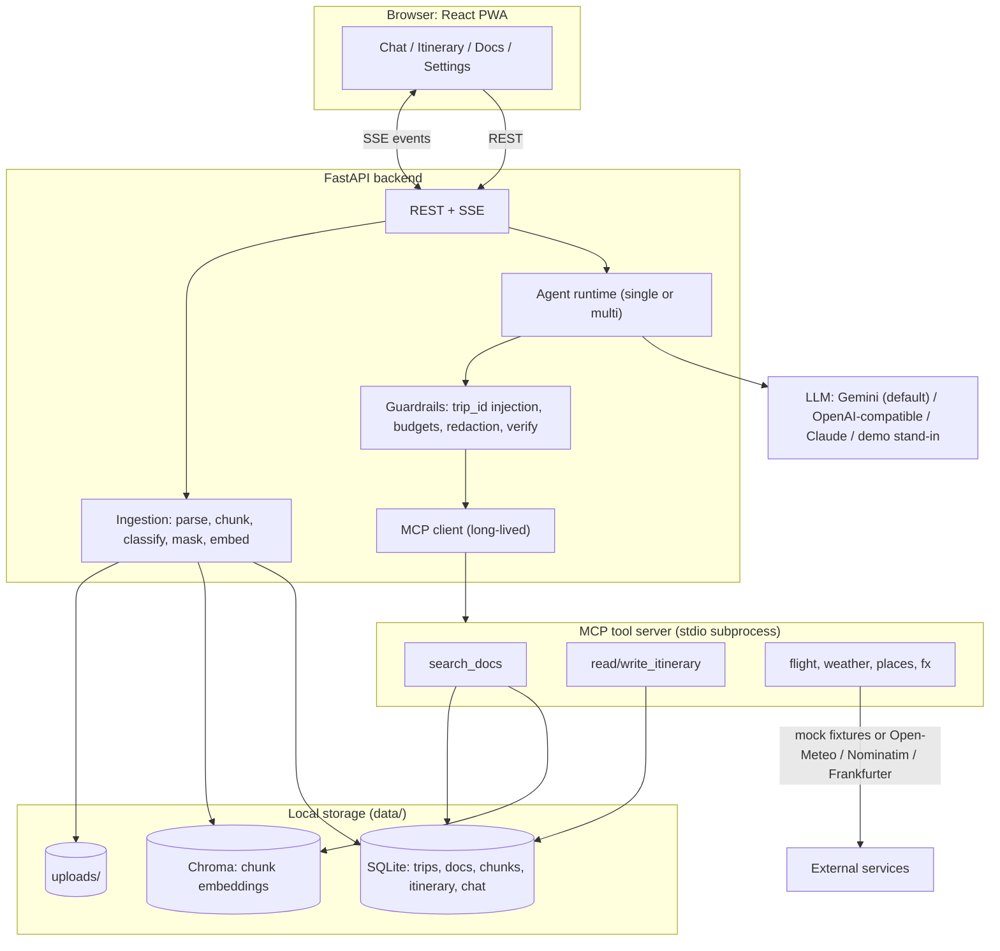
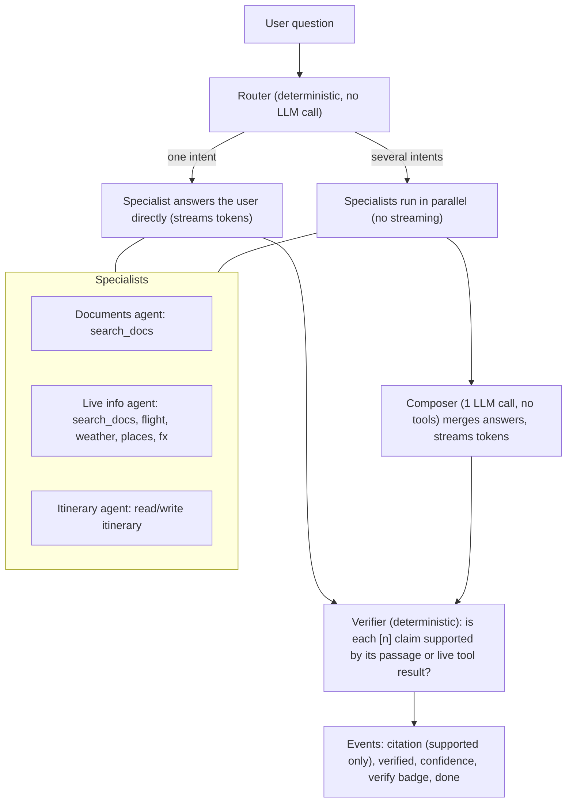
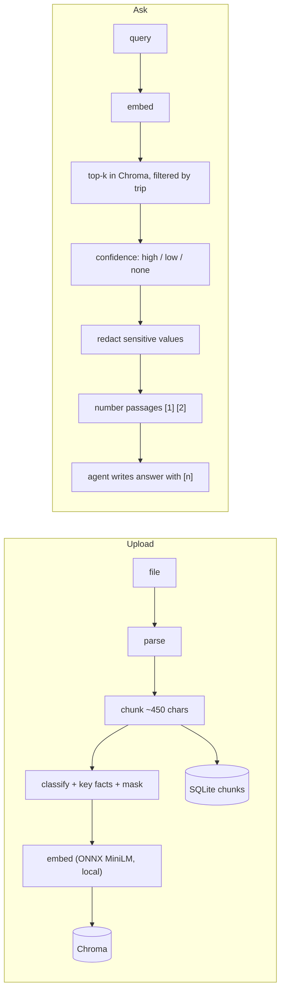

# TripMate architecture

## System

## One chat turn: multi-agent mode (`AGENT_MODE=multi`, default)

- Router intents: `docs`, `live`, `itinerary`. Unmatched questions go to the documents agent.
- Each specialist has its own prompt and a tool allowlist; calls outside the list are rejected.
- Budgets (6 tools per turn, 30 external calls per conversation) and `trip_id` injection are turn-wide and enforced by the backend, not the model.
- `AGENT_MODE=single` keeps the original one-agent loop (all tools). A request can override with `agentMode`.
- `scripts/compare_modes.py` runs both modes on the same questions (LLM calls, time, citations, dropped citations).

## RAG

