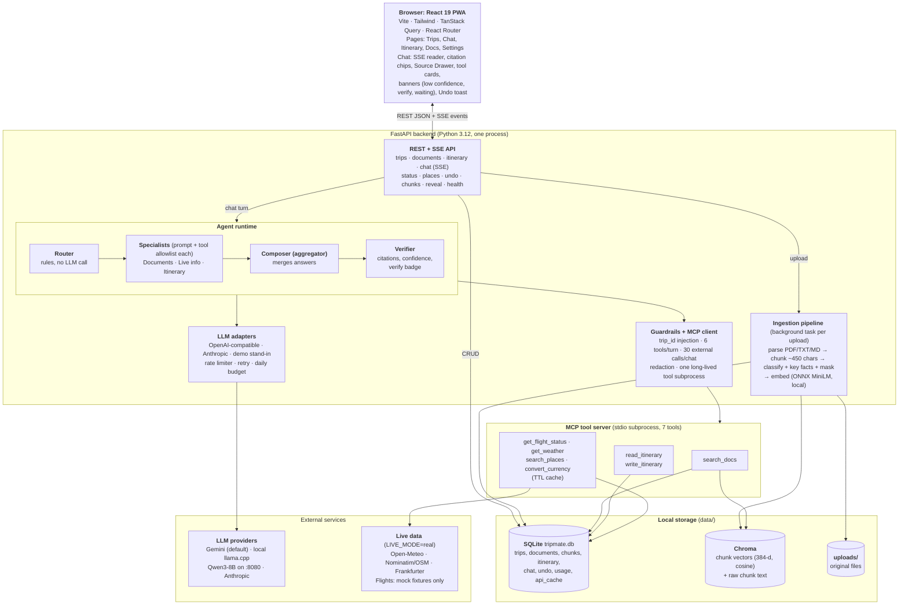
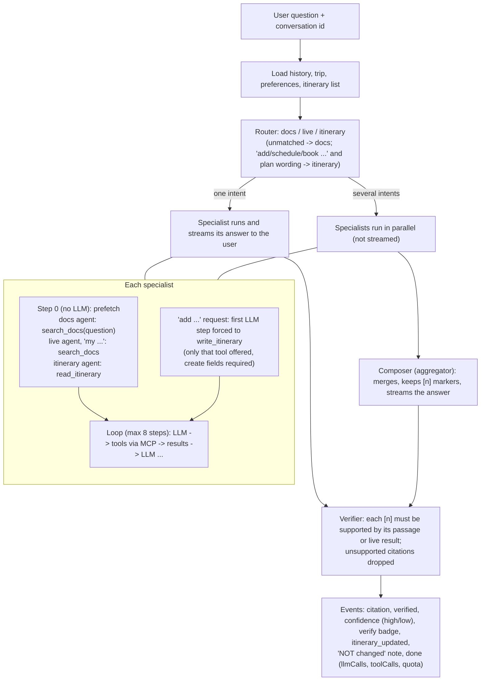
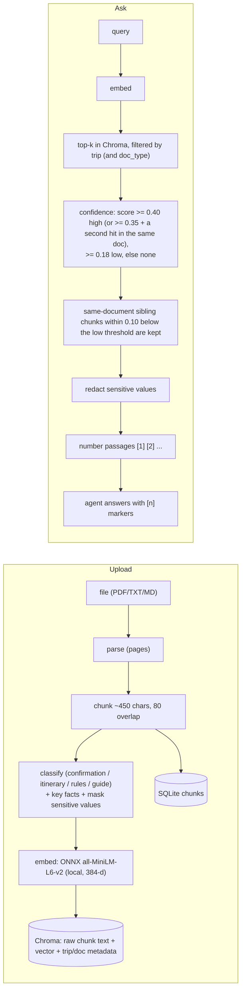

# TripMate architecture

Last reviewed against the code: 2026-11-11 (commit after `ced191b`). Diagrams are Mermaid: they render on GitHub and in VS Code (Markdown preview with a Mermaid extension).
Where this document and the code disagree, the code wins; fix the document.

## 1. Block diagram: all components

Reading the diagram:
- **The browser only talks to the REST/SSE layer.** Everything the model can do goes through the guardrails and the MCP tool server. The agent code reads only the chat history and the traveler's itinerary list directly (to put them in the prompt); it never reads the vector store.
- **One backend process plus one subprocess.** The FastAPI app contains the ingestion task and the agent runtime and spawns the MCP tool server over stdio. SQLite and Chroma are files on disk; there are no database servers.
- **Agent internals** (prefetch, forced write, parallel specialists, verification) are in section 2.
- **Not built:** offline PWA (service worker, local cache), map screen, real flight provider. Settings still shows "offline not enabled".

## 2. One chat turn (multi mode, `AGENT_MODE=multi`, default)

Rules worth knowing:
- Router intents: `docs`, `live`, `itinerary`. Rules first, no LLM call. Only when no rule matches at all (`matched_any`), one short tool-less LLM call (`ROUTER_LLM_FALLBACK`, default on, never with the demo provider) picks the intents from the question plus the previous user turn; the reply is filtered to the three known agents and any failure keeps the documents-agent default. The UI shows it as a "router" agent step. Docs-strong words (check-out, rules, visa, medication, ...) always include the documents agent.
- Every agent's prompt also lists the traveler's own itinerary (marked as *not a document*, never cited) so plan questions work even when routed elsewhere.
- Prefetching and forcing exist because small local models sometimes skip a lookup or copy an earlier "not found" reply from the history; a fresh tool result is always in front of the model.
- Budgets (6 tools per turn, 30 external lookups per conversation), `trip_id` injection and tool allowlists are enforced by the backend, not the model.
- Confidence: document confidence comes from retrieval (section 3); an answer built only on live tool data shows no document-confidence badge; itinerary writes skip it too.
- `AGENT_MODE=single` is the original one-agent loop with all tools (it can skip the document search with small models). A request may override with `agentMode`.
- `scripts/compare_modes.py` runs both modes on the same questions (time, LLM calls, citations, dropped citations).

## 3. RAG

- Chroma stores the **raw** chunk text; masking happens on the way out (search results, chunk endpoint, API). Only the explicit reveal endpoint returns a raw value, for 30 seconds.
- Thresholds live in `config.py` and were calibrated on the sample documents only; they are re-tuned by the Phase 6 eval set.
- Embedding backend: `EMBEDDINGS=onnx` (default; model downloaded once from AWS S3), `fastembed` (needs huggingface.co), `hash` (tests only). Changing it requires `scripts/reindex.py` (dimensions differ).
- Inspect the store with `scripts/inspect_rag.py` (HTML report, read-only) or by opening a **copy** of `data/chroma/chroma.sqlite3`; vectors live in the HNSW `.bin` files and are not visible in SQLite.

## 4. LLM layer

| Provider (`LLM_PROVIDER`) | Adapter | Notes |
|---|---|---|
| `gemini` (default) | OpenAI-compatible endpoint of the Gemini API | `gemini-3.5-flash-lite`; `reasoning_effort=low`; schemas sanitized (no `anyOf`-null/`title`/`default`, parameters named `title` kept); thought signatures echoed back, dummy signature for app-made calls; 12 requests/min and 500/day client-side limits |
| `openai` | OpenAI-compatible (Groq, llama.cpp, Ollama, ...) | the local model path: `llama-server` with Qwen3-8B, `LLM_BASE_URL=http://localhost:8080/v1`; read timeout `LLM_TIMEOUT_SECONDS` |
| `anthropic` | Anthropic SDK | internal canonical message format is Anthropic-shaped blocks |
| `demo` | rule-based stand-in | not an AI; for tests, E2E and demos without a key |

Common behaviour: a process-wide per-minute limiter queues requests (a `waiting` SSE event drives an amber banner), `Retry-After` / `retryDelay` are honoured, daily exhaustion is detected, a persistent daily counter lives in `llm_usage`, and SDK retries are disabled so every request is counted.

## 5. Data model (SQLite `tripmate.db`)

| Table | Purpose |
|---|---|
| `trips` | name, destinations, dates, timezone |
| `documents` | upload metadata, status (queued/processing/ready/failed), type, key facts (sensitive ones masked) |
| `chunks` | chunk text and page per document (mirror of what is in Chroma; ids match) |
| `itinerary_items` | items with `source` = `user` or `agent`, optional time range, conflict detection on read |
| `conversations`, `messages` | chat history (last 20 messages go to the model) |
| `undo_log` | what is needed to reverse an agent write (`/undo/{id}`) |
| `llm_usage` | per-day, per-model LLM request counter (the daily quota) |
| `usage` | external tool calls per conversation (the 30-per-chat budget) |
| `api_cache` | TTL cache for live tool results (also serves stale results if a provider fails) |

## 6. Configuration switches (`.env`, real environment variables win)

| Variable | Values | Effect |
|---|---|---|
| `LLM_PROVIDER` | gemini / openai / anthropic / demo | which model backs the agents |
| `AGENT_MODE` | multi / single | agent architecture (per-request `agentMode` overrides) |
| `ROUTER_LLM_FALLBACK` | true / false | ask the LLM to route questions no rule matches (one extra request on a miss) |
| `VERIFIER_LLM_RESCUE` | true / false | one batched LLM check of citations the word-overlap verifier rejected; it can only restore a citation, and every number/time in the statement must still appear in the passage |
| `LIVE_MODE` | mock / real | fixtures vs Open-Meteo, Frankfurter, Nominatim |
| `LIVE_FLIGHTS` | mock / real | flights stay mock even in real mode (no real provider; `real` fails clearly) |
| `EMBEDDINGS` | onnx / fastembed / hash | embedder for ingestion and search |
| `LLM_MAX_RPM`, `LLM_DAILY_LIMIT`, `LLM_MAX_WAIT_SECONDS`, `LLM_TIMEOUT_SECONDS` | numbers | rate-limit and timeout handling |
| `TRIPMATE_DATA_DIR` | path | where SQLite, Chroma and uploads live (resolved against the repo root) |

## 7. Repository map

`backend/app/` (`routes/`, `services/`, `ingest/`, `agent/` = router, prompt, loop, llm, ratelimit, verify, hub, demo_llm, guardrails; `tools/` = tool implementations and providers; `vectors.py`, `confidence.py`, `db.py`, `config.py`) · `mcp-server/tripmate_mcp/` · `web/src/` (`pages/`, `components/`, `lib/` incl. the SSE reducer, `api/`) · `scripts/` (llm_check, chat_cli, compare_modes, inspect_rag, debug_itinerary, demo_seed, mcp_call, reindex) · `samples/` · `docs/` · `e2e/`.
