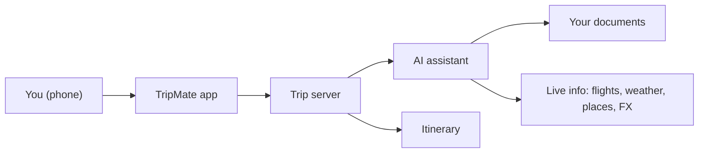

# TripMate: A Travel Assistant for the Road

## What It Is

TripMate is a phone app that helps a traveler while they are on a trip. You upload your booking confirmations, itineraries, and local rules, and then you can ask questions in plain language. The app answers from your own documents, shows where each answer came from, and admits when it doesn't know. It also checks live flight status, weather, nearby places, and exchange rates, and it can add things to your itinerary.

It runs in the phone's browser and can be added to the home screen like an app. It keeps working on a plane or in a subway, where the network is weak or missing.

## Who It Is For

Travelers who want their trip details in one place and quick answers without searching through email, PDFs, and bookmarks. It is most useful on the day itself: checking check-out time, finding dinner, or seeing whether a flight is delayed.

## What You Can Do With It

You start by creating a trip with its dates and destinations. Then you add your documents. Each document shows whether it is still being read or is ready to use.

Once ready, you can ask things like:

- "What time is check-out, and does the hotel include breakfast?"
- "Is my 6 PM flight delayed?"
- "What's the rule for bringing medication into Japan?"
- "Find a vegetarian place near my hotel that's open now."
- "Add a dinner reservation at 8 PM tomorrow."

Each answer based on your documents includes a source chip. Tap it to see the exact passage. If the documents don't contain the answer, the app says so and suggests checking an official source. Questions about visas, medication, customs, or currency rules always carry a reminder to verify.

The itinerary shows your plans day by day, with today at the top. You can edit it yourself, or let the assistant make changes. Any change the assistant makes is marked and can be undone for about 10 seconds. The app also warns you if two plans overlap.

Sensitive details such as passport numbers, booking references, and card digits are hidden by default. You tap to reveal them, and they hide again after 30 seconds.

## How Trust Is Handled

TripMate is built around not guessing. Every factual answer either cites a document or says that it could not find the answer. Time-sensitive topics are flagged. Documents and API keys stay on the trip's own server rather than on the phone, so the phone holds only the itinerary, masked document details, and recent chat needed for offline use.

Some information does leave the system: live lookups for flights, weather, places, and exchange rates are sent to outside services. The app's settings screen lists these services and when each was last contacted.

## How It Is Built, in Plain Terms

The phone app is the part you see. It talks to a small server that runs on the trip's host computer. That server holds the document store, the itinerary, and the keys for outside services. It asks an AI model to read the question, decide what to look up, and write the answer. A separate local helper, called a tool server, performs the lookups: searching your documents, checking flights and weather, and changing the itinerary.

The design keeps secrets on the server and lets each part be tested separately.

## What Is Not in the First Version

To keep the project achievable in three weeks, these are left out: live booking or payments, voice input, background alerts (such as a gate change pushed to your phone), packing checklists, and sharing trips with other people. Some of these may come later.

## How the Project Is Organized

The work is split across a small team: one person on the assistant's behavior and quality checks, one on document reading and search, one on the tool server and outside services, one on the app screens, and one floating for testing and documentation. A team of four to five people can deliver the core experience within three weeks. The full set of features would take about 70 to 87 person-days, so the first release focuses on the five example questions above and cuts the map screen and offline editing if time runs short.

## What Success Looks Like

At the end of three weeks, a traveler can install the app on a phone, upload a booking confirmation, and get a correct, cited answer to a check-out question. They can ask about a flight, look up a restaurant, add a dinner plan, and undo a change. The app works with airplane mode on, and a short recorded demo shows the full experience.

## Open Decisions

The team still needs to confirm which outside services are approved and who sets up their accounts, which sample documents will be used for testing, and whether the app will be shown on iPhone, Android, or both. Answers to these shape the final schedule.

## Glossary

**Source chip**: a tappable marker that opens the passage an answer came from.

**Verify badge**: a reminder that an answer should be checked against an official source.

**Installable app**: a web app that can be added to the phone's home screen and opens like a native app.

**Itinerary**: the day-by-day plan of flights, stays, reservations, and activities.
