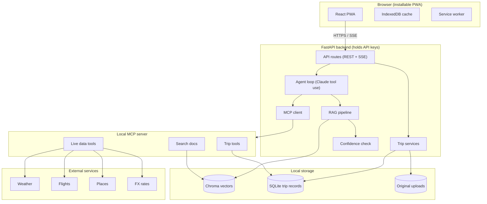
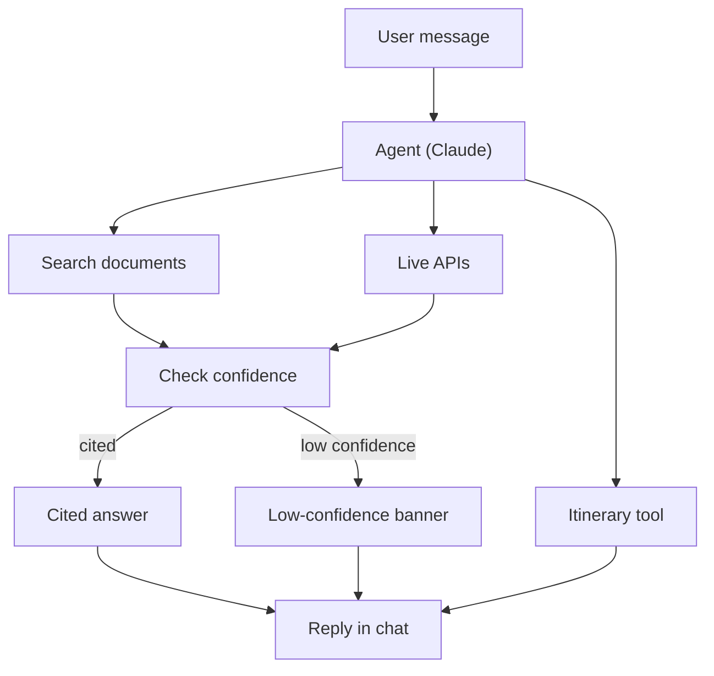

# TripMate Technical Specification

Version: 0.1 (draft for team review)
Scope: MVP for a 3-week sprint, team of 4 to 5
Audience: engineers, reviewers, and anyone rewriting or extending this spec

---

## 1. Purpose

TripMate is a mobile-first travel assistant for a traveler during a trip. It answers questions from the traveler's own documents (retrieval-augmented generation), fetches live data (flights, weather, places, currency), and makes changes to a local itinerary through an agent that uses tools. It is delivered as an installable progressive web app (PWA) backed by a local FastAPI service.

## 2. Goals and Non-Goals

### Goals

- Answer trip-specific questions from uploaded documents, with a citation for every factual answer.
- Say "I don't know" or show a low-confidence banner when documents do not support an answer.
- Show live flight status, weather, nearby places, and currency conversion.
- Let the agent read and write the itinerary, with an undo path for every agent write.
- Work offline for the itinerary, document facts, and keyword search over document text.
- Keep API keys and raw documents off the device.

### Non-Goals (MVP)

- Live booking or payments
- Voice input (stretch)
- Proactive background alerts
- Packing checklists
- Multi-user collaboration
- Native mobile apps (PWA only)

## 3. Architecture

### 3.0 System Diagram



### 3.1 Components

| Component | Responsibility | Technology |
|---|---|---|
| Browser PWA | UI, offline cache, service worker, SSE client | React, Vite, TypeScript, Tailwind, TanStack Query, Zustand, Dexie, vite-plugin-pwa, Leaflet |
| FastAPI backend | REST and SSE endpoints, agent loop, RAG pipeline, confidence check, trip services, MCP client | Python, FastAPI, Claude API (tool use) |
| RAG store | Chunk embeddings and metadata | Chroma (or SQLite with sqlite-vec) |
| Relational store | Trips, itinerary items, sessions | SQLite |
| File store | Original uploaded documents | Local filesystem |
| Local MCP server | Exposes tools to the agent: document search, itinerary read/write, live data | Python MCP SDK |
| External services | Weather, flights, places, currency rates | OpenWeatherMap, AviationStack, Google Places (or OpenStreetMap), exchangerate.host |

### 3.2 Trust Boundaries

- The browser never calls the MCP server or external APIs directly.
- The FastAPI backend holds the Claude API key and all external API keys.
- Raw document text is stored only on the backend. The browser stores only masked key facts and cached chunks needed for offline keyword search.
- The local MCP server runs on the same host as the backend.

### 3.3 Request Flow (chat question)



The itinerary path skips the confidence check because it performs an action rather than giving an answer.

Numbered steps:

1. The browser sends `POST /api/trips/{id}/chat` with the user message.
2. The agent loop calls Claude with the tool definitions and the trip context.
3. Claude selects zero or more tools: document search, live APIs, or itinerary read/write.
4. The backend executes each tool call through the MCP client and streams `tool_start` and `tool_result` events.
5. The RAG result passes through the confidence check. Factual answers must carry at least one citation.
6. The backend streams tokens, citation markers, confidence level, and verify flags.
7. If the agent wrote to the itinerary, the backend emits `itinerary_updated`.
8. The browser renders the answer, invalidates the itinerary query if needed, and shows an Undo toast for agent writes.

## 4. Functional Requirements

Requirement IDs are referenced by tests and the evaluation set.

### 4.1 Trips and Documents

| ID | Requirement |
|---|---|
| TRIP-01 | A user can create a trip with name, destinations, start date, end date, and timezone. |
| TRIP-02 | A user can switch between stored trips. |
| DOC-01 | A user can upload PDF and text documents to a trip. |
| DOC-02 | Each document shows ingestion status: queued, processing, ready, or failed. |
| DOC-03 | Documents are classified by type: confirmation, itinerary, rules, or guide. |
| DOC-04 | Key facts (check-in, check-out, confirmation number) are extracted and shown as cards. |
| DOC-05 | Sensitive fields (passport number, booking reference, card digits) are masked by default. |
| DOC-06 | A masked field can be revealed by tap and re-masks after 30 seconds. |
| DOC-07 | Image uploads with OCR are a stretch goal, not in the MVP. |

### 4.2 Chat and Agent

| ID | Requirement |
|---|---|
| CHAT-01 | Answers stream token by token. |
| CHAT-02 | Each factual answer includes at least one citation chip, or a low-confidence banner. |
| CHAT-03 | Tapping a citation opens the Source Drawer with the chunk, surrounding paragraph, document name, and page. |
| CHAT-04 | Tool calls appear as collapsed cards that can be expanded. |
| CHAT-05 | Time-sensitive topics (visa, medication, customs, currency rules) show a verify badge. |
| CHAT-06 | A user can stop a streaming answer. Partial text stays visible with a retry button. |
| CHAT-07 | Suggested prompts appear when the chat is empty, drawn from the trip's documents. |
| CHAT-08 | Quick-action chips: today's plan, weather, flight status, nearby food. |
| CHAT-09 | Each chat session has a per-session budget for external API calls. |

### 4.3 Live Data

| ID | Requirement |
|---|---|
| LIVE-01 | Flight status shows delays and gate changes for itinerary flights or an ad hoc query. |
| LIVE-02 | Weather shows the destination forecast for upcoming days. |
| LIVE-03 | Places search returns nearby results with rating, open-now status, and distance. Supports a vegetarian filter. |
| LIVE-04 | Currency conversion uses current rates with a visible timestamp. |
| LIVE-05 | Every live result shows its last-updated time. Offline, cached results are labeled stale. |
| LIVE-06 | External calls are cached with a time-to-live per data type. |

### 4.4 Itinerary

| ID | Requirement |
|---|---|
| ITIN-01 | Day-by-day timeline opens on today. |
| ITIN-02 | Item types: flight, hotel, reservation, activity, transit, note. |
| ITIN-03 | Users can create, edit, and delete items through a bottom sheet. |
| ITIN-04 | The agent can create, update, and delete items through the itinerary tool. |
| ITIN-05 | Agent-made changes show an "Added by TripMate" badge and an Undo toast for about 10 seconds. |
| ITIN-06 | Overlapping items show a conflict warning. |
| ITIN-07 | Itinerary reads work offline. Writes made offline are queued and synced on reconnect. |

### 4.5 Map

| ID | Requirement |
|---|---|
| MAP-01 | Pins for the hotel, itinerary items, and latest places results. |
| MAP-02 | Tapping a pin opens a place card with name, rating, open status, distance, and an Add to itinerary action. |
| MAP-03 | "Center on hotel" and "Show my day" actions. |
| MAP-04 | Map is the first item cut if scope slips. |

### 4.6 Settings and Privacy

| ID | Requirement |
|---|---|
| SET-01 | Connection status for each external integration, with last-checked time. |
| SET-02 | Units (metric or imperial), display currency, and answer language. |
| SET-03 | Offline storage info: last sync time, size used, and a clear-cache action. |
| SET-04 | Privacy note describing what is stored on the device and what leaves it. |

### 4.7 Accessibility and Platform

| ID | Requirement |
|---|---|
| A11Y-01 | Tap targets are at least 44px. Input font is at least 16px. |
| A11Y-02 | Composer stays above the on-screen keyboard. |
| A11Y-03 | Streaming answers are announced once through a live region, not token by token. |
| A11Y-04 | `prefers-reduced-motion` disables streaming cursor and transition animation. |
| A11Y-05 | Dark mode applies by default after 8 PM local time or when the system is dark. |
| A11Y-06 | Layout works at 375px width with one-handed use. |
| PWA-01 | App is installable to the phone home screen. |
| PWA-02 | App shell loads with no network. |

## 5. API Specification

### 5.1 REST Endpoints

| Method | Path | Purpose |
|---|---|---|
| GET | `/api/trips` | List trips |
| POST | `/api/trips` | Create trip |
| GET | `/api/trips/{id}` | Trip details with itinerary and document summaries |
| POST | `/api/trips/{id}/documents` | Upload document (multipart) |
| GET | `/api/trips/{id}/documents/{docId}/status` | Ingestion status |
| GET | `/api/documents/{docId}/chunks/{chunkId}` | Source Drawer content |
| GET | `/api/trips/{id}/itinerary` | List itinerary items |
| POST | `/api/trips/{id}/itinerary` | Create itinerary item |
| PATCH | `/api/trips/{id}/itinerary/{itemId}` | Update itinerary item |
| DELETE | `/api/trips/{id}/itinerary/{itemId}` | Delete itinerary item |
| GET | `/api/trips/{id}/places?lat=&lng=&q=` | Places search |
| GET | `/api/trips/{id}/status` | Health of each external integration |

### 5.2 Chat Streaming

`POST /api/trips/{id}/chat` with body `{ "message": string, "conversationId": string }`. The response is a Server-Sent Events stream of typed events.

```ts
type ChatEvent =
  | { type: "token"; text: string }
  | { type: "tool_start"; toolCallId: string; name: string; label: string }
  | { type: "tool_result"; toolCallId: string; ok: boolean; summary: string }
  | { type: "citation"; marker: string; docId: string; chunkId: string; label: string }
  | { type: "confidence"; level: "high" | "low" | "none" }
  | { type: "verify"; reason: string }
  | { type: "itinerary_updated"; itemId: string; action: "created" | "updated" | "deleted" }
  | { type: "error"; code: string; message: string; retryable: boolean }
  | { type: "done"; messageId: string };
```

Client behavior:

- `token`: append to the current assistant message.
- `tool_start`: insert a collapsed tool card.
- `citation`: replace the matching `[n]` marker with a chip.
- `confidence` with `low` or `none`: show the low-confidence banner.
- `verify`: show the verify badge.
- `itinerary_updated`: invalidate the itinerary query and show the Undo toast.
- `error` with `retryable: true`: keep partial text and show Retry.
- `done`: finalize the message and announce it to screen readers.

### 5.3 Error Model

All REST errors return `{ "error": { "code": string, "message": string, "retryable": boolean } }`. Codes used in the MVP: `NOT_FOUND`, `VALIDATION_FAILED`, `INGEST_FAILED`, `EXTERNAL_UNAVAILABLE`, `BUDGET_EXCEEDED`, `AGENT_FAILED`.

## 6. Data Model

### 6.1 Server (SQLite)

| Table | Key fields |
|---|---|
| trips | id, name, destinations, start_date, end_date, timezone, created_at |
| documents | id, trip_id, filename, doc_type, status, uploaded_at, key_facts (JSON) |
| chunks | id, document_id, page, text, metadata (JSON) |
| itinerary_items | id, trip_id, type, title, start_at, end_at, location, notes, source (user or agent), document_id |
| conversations | id, trip_id, created_at |
| messages | id, conversation_id, role, content, created_at |
| api_cache | key, payload, fetched_at, ttl_seconds |

Chroma holds chunk embeddings keyed by `chunks.id`, with `trip_id`, `doc_type`, and `document_id` as filter metadata.

### 6.2 Browser (IndexedDB via Dexie)

| Store | Contents | Offline behavior |
|---|---|---|
| itinerary | Full copy of trip itinerary | Read and queued write |
| docs | Metadata, key facts (masked), chunks for keyword search | Read; keyword search only |
| chat | Last 100 messages | Read |
| live | Last live response with timestamp | Read, labeled stale |
| syncQueue | Pending itinerary writes | Replayed on reconnect |

No API keys or raw document text beyond the masked user-visible cache are stored in the browser.

## 7. Agent and RAG Behavior

### 7.1 Tools exposed to the agent (via MCP)

| Tool | Input | Output |
|---|---|---|
| `search_docs` | query, trip_id, optional doc_type | Ranked chunks with document, page, score |
| `get_flight_status` | flight number, date | Status, delay, gate, last updated |
| `get_weather` | location, days | Forecast summary, last updated |
| `search_places` | location, query, filters | Places with rating, open status, distance |
| `convert_currency` | amount, from, to | Converted amount, rate, last updated |
| `read_itinerary` | trip_id, date range | Items |
| `write_itinerary` | action, item fields | Created, updated, or deleted item ID |

### 7.2 Guardrails

- Factual answers must cite at least one chunk, or the response must set confidence to `low` or `none`.
- If retrieval confidence is below the threshold, the agent must say it could not find the answer in the documents and offer an official-source suggestion.
- Answers on visas, medication, customs, and currency rules always emit a `verify` event.
- The agent may call at most a fixed number of tools per turn (proposed: 6) and a fixed number of external API calls per session (proposed: 30).
- Itinerary writes by the agent must set `source = agent` so the UI can badge and undo them.

### 7.3 Confidence Check

Retrieval returns a similarity score per chunk. The confidence level is derived from the top score and from whether the top chunks agree. Thresholds are tuned during Week 2 using the evaluation set. Initial values to be set by the RAG owner.

## 8. Non-Functional Requirements

| Area | Requirement |
|---|---|
| Latency | First streamed token within 3 seconds for document questions on a local backend (target, not guaranteed; depends on model and network). |
| Security | Keys in backend environment only. Document storage local. Logs exclude raw document text. |
| Privacy | Sensitive fields masked in UI. Redaction before any cloud call where possible. |
| Reliability | Partial answers preserved on failure. Backend unreachable shows cached itinerary and docs. |
| Cost | External API caching and per-session budgets. Budgets are configurable. |
| Accessibility | Meets the A11Y requirements in section 4.7. |
| Testing | Unit tests for logic, Playwright E2E at phone viewports for the five demo flows, and an evaluation set of 30 to 50 questions. |

## 9. Demo Scope (Acceptance Flows)

The MVP is accepted when these five flows pass end to end from a phone browser:

1. "What time is my check-out and does the hotel include breakfast?" answered with a citation from the booking confirmation.
2. "Is my 6 PM flight delayed?" answered from the flight status tool, with a last-updated time.
3. "What's the rule for bringing medication into Japan?" answered from a saved rules document, with a verify badge.
4. "Find a vegetarian place near my hotel that's open now." returning place results with an Add to itinerary action.
5. "Add a dinner reservation at 8 PM to tomorrow's itinerary." creating an itinerary item, showing the agent badge, and offering Undo.

## 10. Milestones

| Week | Milestone | Exit criterion |
|---|---|---|
| 1 | Foundations | A question about a sample booking returns a cited answer. Mock chat streams with citations on a phone viewport. |
| 2 | Integration | All five demo flows work end to end on the real backend. Offline cache for itinerary and docs in place. |
| 3 | Hardening | E2E suite passes. App installs to home screen. Offline demo works in airplane mode. Evaluation report written. |

## 11. Scope Management

Scope cut order if the schedule slips:

1. Map screen (keep places in chat).
2. Offline writes (keep read-only offline).
3. OCR and image uploads (already out of MVP).
4. Docs screen simplified to a list.
5. Source Drawer simplified to a text view.

Do not cut: citations, confidence and verify behavior, itinerary read and agent write with undo, or the five demo flows.

## 12. Estimate Summary

| Scope | Person-days |
|---|---|
| Full scope | 70 to 87 |
| MVP after cuts | 55 to 68 |

Capacity is 15 person-days per member over three weeks. A team of 4 fits the MVP with little slack; a team of 5 has a reasonable margin. Accuracy is roughly plus or minus 25 percent.

## 13. Open Questions

1. Which flight, places, and currency providers are approved for the team, and who owns billing setup?
2. What is the real document set for testing (sample confirmations, rules documents)?
3. Is Chroma or sqlite-vec preferred for the vector store?
4. Who owns the evaluation set and the pass threshold?
5. Is the app used on iOS, Android, or both for the demo?

## 14. Glossary

- **RAG**: retrieval-augmented generation. The model answers using retrieved passages from the user's documents.
- **MCP**: Model Context Protocol. A standard for exposing tools to an AI model.
- **SSE**: Server-Sent Events. One-way streaming from server to browser over HTTP.
- **PWA**: progressive web app. An installable web app with offline support.
- **Chunk**: a passage of a document, the unit that is embedded and retrieved.
- **Citation chip**: a tappable marker that opens the source passage.
- **Verify badge**: a visible warning that an answer should be checked against an official source.
